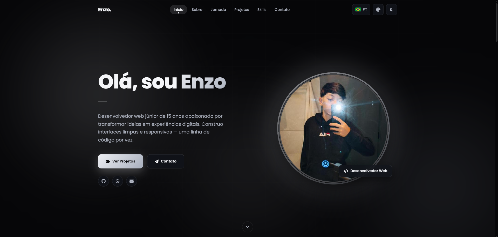

<div align="center">

# ✨ Portfólio — Enzo Nascimento

**Desenvolvedor Web Júnior · Front-End & Back-End**

Portfólio pessoal moderno, responsivo e acessível — construído do zero com
**HTML5**, **CSS3** e **JavaScript** puro (ES Modules), sem frameworks.

[](#)
[](#)
[](#)
[](LICENSE)

[**🔗 Ver ao vivo**](https://destypc.github.io/Projeto-Portfolio/) · [**💻 Código**](https://github.com/destypc/Projeto-Portfolio)

<br/>



</div>

---

## 🚀 Sobre o projeto

Este é o meu portfólio pessoal, onde reúno quem sou, minha jornada como
desenvolvedor e os projetos que venho construindo. Foi desenvolvido com foco em
**design profissional**, **performance** e **experiência do usuário** — cada
detalhe (troca de tema, animações, responsividade) foi feito à mão em código
puro, como exercício de domínio dos fundamentos da web.

---

## ✨ Funcionalidades

- 🌗 **Tema claro/escuro** com revelação circular fluida via [View Transitions API](https://developer.mozilla.org/docs/Web/API/View_Transitions_API) (com _fallback_ para navegadores sem suporte)
- 🎨 **Cor de destaque personalizável** — 8 paletas de _accent_ que se adaptam ao tema
- ⏳ **Tela de carregamento** (_preloader_) com saída em _fade_
- 📱 **Totalmente responsivo** — do mobile 320px ao desktop widescreen
- 🧭 **Navegação suave** com _scrollspy_ (destaque da seção atual) e barra de progresso de leitura
- 🎞️ **Animações de entrada** ao rolar (fade + translate + blur, com _stagger_)
- 🪄 **Microinterações** — inclinação 3D (_tilt_), _spotlight_ nos cards e parallax leve
- 🛤️ **Jornada interativa** — carrossel horizontal com _slider_ arrastável
- ⌨️ **Efeito de digitação** no _hero_
- ♿ **Acessibilidade** — navegação por teclado, `aria-*`, _skip link_ e respeito a `prefers-reduced-motion`
- ⚡ **Performance** — animações em `transform`/`opacity` com `requestAnimationFrame` mirando 60 FPS

---

## 🛠️ Tecnologias

<div align="center">

| Tecnologia | Uso |
|---|---|
| **HTML5** | Estrutura semântica e SEO (Open Graph, meta tags) |
| **CSS3** | Design tokens (`custom properties`), `color-mix()`, `clamp()`, Grid & Flexbox, animações |
| **JavaScript (ES Modules)** | Tema, interações, animações e navegação — sem dependências |
| **Font Awesome 6** | Ícones |
| **Google Fonts** | Tipografia (Poppins) |

</div>

---

## 📂 Estrutura do projeto

```bash
📦 Projeto-Portfolio
 ┣ 📂 assets
 ┃ ┣ 📂 css
 ┃ ┃ ┣ 📜 variables.css      # Design tokens (cores, tipografia, espaçamento)
 ┃ ┃ ┣ 📜 style.css          # Estilos principais
 ┃ ┃ ┗ 📜 responsive.css     # Breakpoints (1024 / 960 / 640 / 400px)
 ┃ ┣ 📂 js
 ┃ ┃ ┣ 📜 main.js            # Ponto de entrada · navegação · preloader
 ┃ ┃ ┣ 📜 include.js         # Monta a página com os arquivos de components/ e sections/
 ┃ ┃ ┣ 📜 i18n.js            # Traduções (PT / EN / ES)
 ┃ ┃ ┣ 📜 theme.js           # Tema claro/escuro e cor de destaque
 ┃ ┃ ┣ 📜 animations.js      # Reveal ao rolar + efeito de digitação
 ┃ ┃ ┗ 📜 interactions.js    # Tilt 3D, spotlight, parallax e carrossel
 ┃ ┗ 📂 images
 ┃   ┣ 📂 skills             # Logos oficiais das tecnologias (SVG)
 ┃   ┗ 📂 flags              # Bandeiras do seletor de idioma
 ┣ 📂 components
 ┃ ┣ 📜 navbar.html          # Cabeçalho, menu, idioma, tema e cores
 ┃ ┗ 📜 footer.html          # Rodapé
 ┣ 📂 sections
 ┃ ┣ 📜 hero.html            # Início
 ┃ ┣ 📜 sobre.html           # Sobre mim
 ┃ ┣ 📜 jornada.html         # Carrossel da jornada
 ┃ ┣ 📜 projetos.html        # Projetos
 ┃ ┣ 📜 skills.html          # Tecnologias por categoria
 ┃ ┗ 📜 contato.html         # Contato
 ┣ 📜 index.html             # Esqueleto: <head>, preloader e os data-include
 ┣ 📜 LICENSE
 ┗ 📜 README.md
```

---

## 💻 Como executar localmente

Por usar apenas arquivos estáticos, basta clonar e abrir no navegador:

```bash
git clone https://github.com/destypc/Projeto-Portfolio.git
cd Projeto-Portfolio
```

Como o projeto usa **ES Modules** e carrega as seções de `components/` e
`sections/` via `fetch`, ele precisa ser servido por um servidor local (abrir o
`index.html` direto pelo arquivo não funciona):

```bash
# Com Python
python -m http.server 5500

# Ou com a extensão "Live Server" do VS Code
```

Depois acesse `http://localhost:5500`.

---

## 🗂️ Seções do site

**Início** · **Sobre** · **Jornada** · **Projetos** · **Skills** · **Contato**

### Projetos em destaque

| Projeto | Descrição | Stack |
|---|---|---|
| [**Brasil Time**](https://destypc.github.io/Brasil-Time/) | Relógio em tempo real, cronômetro, temporizador e calendário com feriados nacionais | HTML · CSS · JavaScript |
| [**SprintMax**](https://sprint-max-crud-production.up.railway.app/pages/dashboard.php) | Sistema de vendas com CRUD completo e painel administrativo | PHP · SQL |

---

## 👤 Autor

**Enzo Nascimento** — Desenvolvedor Web Júnior · Jovem Aprendiz na Gazin Tech (Paraná, Brasil)

[](https://github.com/destypc)
[](https://wa.me/554599857429)
[](mailto:enzopontesdonascimento@gmail.com)

---

## 📄 Licença

Distribuído sob a licença **MIT**. Veja o arquivo [LICENSE](LICENSE) para mais detalhes.

<div align="center">

Feito com ❤️ e muito código por **Enzo Nascimento**

</div>
